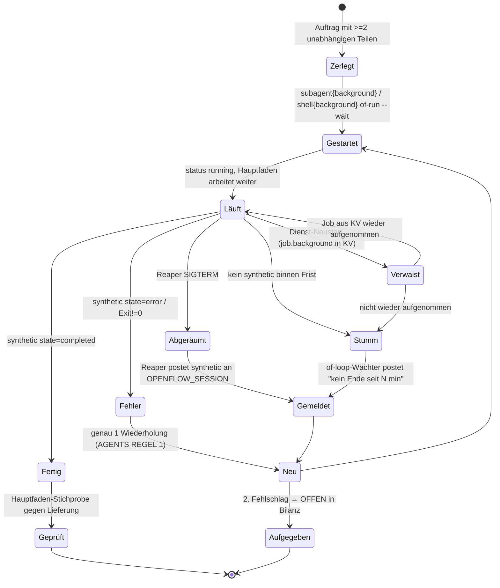

# Autonomie 10/10 in opencode + OpenFlow + dharma — Plan v1.0

**Datum:** 23.10.2026 · **Status:** W0 bestanden (18/18) · W1, W2, W3 umgesetzt · W4 gemessen · W5 (Messwoche 24.–30.10.) offen · **unabhängige Abnahme 23.10.2026: 2/10, Runde 2: 2/10** (Feld-Nachweis UNGEPRÜFT; ohne ihn wäre dharma mit 5 das schwächste Glied) — Einzelheiten im Abschnitt „Stand nach der Abnahme“ am Ende

Quelle: freigegebener Plan v1.0 vom 23.10.2026, unverändert übernommen; ergänzt sind die Messwerte aus W2.1 (Abschnitt „W2 — Messung und Umsetzung" am Ende) und Korrekturen, wo die Messung eine Annahme verschoben hat.

## 1. Kontext

Ziel: Der opencode-Hauptfaden soll so lange allein durchlaufen wie Claude Code. Dazu gehört Folgendes:
- unabhängige Teile parallel im Hintergrund starten und weiterarbeiten;
- die Ergebnisse kommen von selbst zurück, ohne Abfragen;
- der Hauptfaden urteilt und prüft stichprobenartig gegen;
- eine unabhängige Abnahme vergibt die Note.

Die Wochenanalyse vom 16. bis 23.10. ergab 6/10. Die Ursachen liegen nicht im fehlenden Können, sondern in Konfiguration, Anweisungen und zwei Defekten.

Entscheidungen des Betreibers vom 23.10.:
- Der Hauptfaden läuft über dharma.
- Claude über antigravity wird nicht getestet.
- Ich darf den Dienst und die Engine neu starten, nach Ankündigung im Text.

Läuft parallel und ist **nicht** Teil dieses Plans: der dharma-Fix-Strang (tote Modellnamen, Canary, authgrund, TTFT). Er ist Vorbedingung für die Messphase W5.

## 2. Annahmen (Phase 1/2, verifiziert durch 3 Explore-Läufe)

| # | Annahme | Status | Beleg |
|---|---|---|---|
| A1 | opencode hat Hintergrund-Subagenten | **VERIFIED**: v2.1.4, `subagent{background:true}` → sofort `running`, Ende als `session.synthetic` an die Eltern | Binary-Schema, Funktion `s2` |
| A2 | Diese Fertig-Meldung weckt eine ruhende Eltern-Sitzung (neuer Turn) | **Code: ja** (`wake` ohne `resume:false`), **live UNGEPRÜFT** | Binary `Session.synthetic … wake` |
| A3 | Ein Shell-Befehl im Hintergrund meldet sein Ende ebenfalls | VERIFIED im Code (`ShellTool.notifyWhenDone`, kein Timeout bei background), live UNGEPRÜFT | Binary `hA=120000` |
| A4 | Ein externer Prozess kann in eine Sitzung posten | VERIFIED: `POST :49374/api/session/:id/synthetic`, Basic Auth aus `service.json`; das Shell-Werkzeug setzt `OPENCODE_SESSION_ID` | Binary-Routen |
| A5 | Ein Fabrik-Run kennt seine Aufrufer-Sitzung | VERIFIED: `OPENFLOW_SESSION` wird von fabrik-gate exportiert; die Ledger-Zeile `fabrik_log` ordnet Log→Session zu | fabrik-gate.ts:382, :368 |
| A6 | Fabrik-Runs scheitern vor allem am Modell | **WIDERLEGT**: 41/201 Runs wurden vom Reaper abgeräumt. Er griff nach 10 Minuten ohne Checkpoint (`of-loop.ts:61`), das Karten-Timeout liegt bei 30 Minuten (`engine.ts:231`). **Nachmessung W2.1:** Die Reaps trafen belegt 36 von 41 tote Läufe, 5 unbestimmt, 0 nachweislich lebende — „Hauptursache Reaper" ist damit nicht belegt; die Schwelle war trotzdem falsch (siehe §W2) | Auswertung `flow-lab/.openflow/runs` |
| A7 | Hauptsitzungen laufen per Konfiguration auf zai | **WIDERLEGT**: Ursache ist die gespeicherte TUI-Modellwahl in `~/.local/state/opencode/model.json`; der Guard prüft `zai` nicht | guard.ts:309-326 |
| A8 | Die Anweisungen verlangen Hintergrund-Arbeit | **WIDERLEGT**: build.md/AGENTS.md verlangen synchrones Auffächern; `background` steht nur in command/frage.md; `direktiven/` wird nie geladen | AGENTS.md:25-41, opencode.jsonc:19-25 |
| A9 | `of-run.sh --wait` liefert den Exit-Code des Runs | **WIDERLEGT**: wegen `\|\| true` immer 0 — **behoben in W2.3** | of-run.sh:129 |
| A10 | Ein Run-Ende läuft immer durch einen Abschlusspunkt | **WIDERLEGT**: headless-run hat keinen SIGTERM-Handler, ein Reap bzw. Kill hinterlässt kein Ergebnis; auch das reguläre Ende schrieb keine `ergebnis.md` (nur den Bericht nach stdout) — **behoben in W2.2** | headless-run.ts:65 |
| A11 | Es gibt Messdaten zur Langlauf-Qualität der Modelle | **WIDERLEGT**: nur externe Benchmarks (glm-5.2 MCP-Atlas 77); kein eigener Agentik-Test | modelle-bewerten.mjs:5-10 |
| A12 | Der opencode-Dienst läuft | UNGEPRÜFT/eher nein: Port 49374 frei, `service.json` zeigt v2.0.32 bei installiertem Binary 2.1.4 | Explore 1 |
| A13 | Die Plugin-Typen (2.0.26) passen zum Binary 2.1.4 | UNGEPRÜFT → wird im Spike mitgemessen | package.json |

## 3. Spike (riskantester Punkt): **W0**

**RISKANTESTER PUNKT:** A2/A3, also ob eine ruhende Hauptsitzung nach der Fertig-Meldung von selbst einen neuen Turn startet und das Ergebnis verwertet. Erst dann besteht die gesamte Architektur aus vorhandenen Bausteinen.

**SPIKE-TYP:** Code-Spike als erster Umsetzungsschritt. Der Planmodus verbietet den Lauf jetzt.
- `opencode run --standalone` in einem Wegwerf-Ordner (nicht über den Dienst, sonst bläht er auf).
- Agent build auf dharma/balanced.
- Auftrag: „starte 2 Hintergrund-Subagenten (je ein `sleep 20; echo X`), beende deinen Turn, fasse danach beide Ergebnisse zusammen".
- Gemessen wird in der DB, ob nach dem Turn-Ende eine `synthetic`-Nachricht folgt, ein neuer Assistant-Turn startet und die Antwort X enthält.
- Dasselbe mit Shell `background:true` und `of-run.sh … --wait`.
- n=3 je Weg und Modell (dharma/balanced, dharma/power, glm-5.3).

**KILL-KRITERIUM:** Weniger als 3/3 Wecken bei einem Weg → das Plugin übernimmt den Rückruf. Der Weg ist dann ein V2-Plugin nach dem auto-resume-Muster, das `fabrik_log` beobachtet und `ctx.session.synthetic` an die Eltern schickt. Statt W1/W2 nur zu konfigurieren, wird W2b gebaut.

## 4. Zustandsautomat: ein Hintergrund-Auftrag aus Sicht des Hauptfadens



Den Automaten zu zeichnen hat zwei vergessene Zustände aufgedeckt:
- **Abgeräumt:** heute ohne jede Meldung, und das ist der häufigste Fall.
- **Stumm/Verwaist:** ein Dienst-Neustart mitten im Lauf.

Beide brauchen eine Meldung von außen, sonst bleibt der Hauptfaden still.

## 5. Komponenten

```mermaid
flowchart LR
  TUI[TUI / Nutzer] --> HF[Hauptfaden build @ dharma/power]
  HF -- subagent background --> SA[Subagenten explore/general @ dharma/balanced]
  HF -- shell background: of-run.sh --wait --> OR[of-run.sh → headless-run → Engine :4096]
  SA -- synthetic completed --> HF
  OR -- Exit-Code + ergebnis.md, notifyWhenDone --> HF
  REAP[of-reap / of-loop Wächter] -- POST /api/session/:id/synthetic --> HF
  GUARD[guard.ts / fabrik-gate.ts] -. prüft Modell + Gate .-> HF
  HF & SA & OR --> DH[dharma Router] --> PROV[zai · yolo · antigravity · clinepass · nvidia]
  LEDGER[(~/.openflow/gate-ledger.jsonl)] --- GUARD
  BENCH[Autonomie-Benchmark] --> HF
```

Grenzen: Secrets bleiben in der Konfiguration und in `service.json` mit Rechten 600. Der Reaper liest das Passwort nur lokal und gibt es nie aus.

## 6. Arbeitspakete (nach Abhängigkeit)

| Welle | Paket | Inhalt | Repo / Datei | hängt ab von |
|---|---|---|---|---|
| 0 | **W0 Spike** | siehe §3, dazu Dienst-Neustart auf 2.1.4 (A12) und Abgleich der Plugin-Typen (A13) | Wegwerf-Ordner | — |
| 1 (parallel) | **W1 Anweisungen** | build.md und AGENTS.md REGEL 1 neu (siehe unten) | `~/.config/opencode/` (lokales git) | W0 |
| | **W2 Fabrik robust** | Reaper-Schwelle, ergebnis.md, Exit-Code, Rückruf bei Reap | OpenFlow `packages/flow` (PR → dev) | W0 |
| | **W3 Hauptfaden über dharma** | `build` fest auf dharma/power; `steps` je Agent setzen; Guard meldet jede TUI-Modellwahl außerhalb von dharma; `model.json` auf dharma/power | `opencode.jsonc`, `plugins/guard.ts` | — |
| 2 | **W4 Autonomie-Benchmark** | fester Aufgabensatz plus Messskript | OpenFlow `packages/flow/bench/` | W1–W3 |
| 3 | **W5 Messwoche + Abnahme** | 7 Tage Betrieb, dann dieselbe Wochenanalyse und unabhängige `abnahme` | — | W4, dharma-Strang live |

### W1 Anweisungen (Inhalt)
- **Hintergrund als Standard:** Unabhängige Teile laufen als `subagent{background:true}`, alle in **einem** Block. Danach arbeitet der Hauptfaden weiter oder beendet seinen Turn mit „warte auf N Hintergrund-Ergebnisse". **Kein** sleep und kein Abfragen.
- Synchrones `subagent` nur, wenn das Ergebnis im selben Schritt gebraucht wird.
- Fabrik: `shell{background:true}` mit `of-run.sh <pipeline> "<task>" --wait`. Die Shell meldet das Ende, das Ergebnis steht in `ergebnis.md`, der Pfad steht in der Ausgabe.
- Der Hauptfaden urteilt: Jede Lieferung bekommt eine eigene Stichprobe (Kontrollwert). Der Widerspruch zu guard.ts:515 („nicht selbst nacharbeiten") wird aufgelöst. Stichprobe heißt nachprüfen, nicht die Arbeit selbst nachholen.
- Widersprüche 3g/3h werden aufgelöst. Es bleibt **eine** Stelle für die Stufen „Subagent oder Fabrik" (AGENTS REGEL 4); mode/fabrik.md verweist nur noch darauf.
- `direktiven/` wird entweder in `instructions` aufgenommen oder in AGENTS.md überführt und gelöscht. Kein toter Ordner.

### W2 Fabrik robust (Inhalt, je mit Test und Gegenprobe)
1. **Reaper gegen Karten-Timeout:** Der Reaper darf erst handeln, wenn das Karten-Timeout plus Puffer abgelaufen ist, oder er nutzt einen Lebenszeichen-Takt der Engine. Ein bloß stiller Checkpoint reicht nicht. Die Ursachenkette ist belegt (A6). Bevor gefixt wird, rechnet der Test die 41 Fälle nach: Wie viele Karten waren beim Abräumen noch innerhalb ihrer 30 Minuten?
2. **headless-run:** Handler für SIGTERM/SIGINT schreibt das Verdict `stopped` und eine `ergebnis.md` (Scorecard plus Karten-Outputs, ≤ 25 KB) neben den Checkpoint. Die Datei wird bei **jedem** Ende geschrieben.
3. **`--wait`** gibt den Exit-Code des Runs zurück (A9).
4. **Rückruf bei Reap:** Der Reaper schlägt in `fabrik_log` die Session nach und postet `synthetic` „Run X abgeräumt, Grund, Checkpoint" über die API (A4). Der Wächter in of-loop meldet „kein Ende seit 45 min" für Läufe im Zustand Stumm.
5. Nebenbefund: `state.json` zeigt auf ein Projekt ohne auto-orchestrator. Prüfen, ob der Canvas das aktive Projekt nutzt (UNGEPRÜFT). Falls ja: die Pipeline wird über einen absoluten Pfad aufgelöst.

### W3 Hauptfaden über dharma (Inhalt)
- `agents.build.model = dharma/power`, bleibt so.
- `steps`: build 200, general/worker 60, explore 40. Begründung: unbegrenzt plus Schleife wäre der teuerste Fehlerfall. Die Zahlen werden nach W4 angepasst.
  - **Umgesetzt mit begründeter Abweichung** (Commit `1b6f657` in `~/.config/opencode`): siehe „Stand nach der Abnahme“, W3 — build ohne Schrittgrenze, die übrigen Werte aus der gemessenen Verteilung statt der Schätzung oben.
- Guard: Liegt die TUI-Wahl außerhalb von `dharma/*`, kommt ein sichtbarer Hinweis, keine Blockade.
- Die Arbeit läuft bei der Flatrate, Geldpfad unverändert: zai-pay steht weiter zuletzt.

### W4 Autonomie-Benchmark
Aufgabensatz B1 bis B5 in einem Wegwerf-Repo mit festem Sollergebnis:
- **B1:** 3 unabhängige Analysen, jede mit einer bekannten Zahl als Kontrollwert.
- **B2:** Fan-out plus abhängiger Fix (Teil B braucht A).
- **B3:** ein Fabrik-Run mit Rückruf.
- **B4:** ein absichtlich scheiternder Subagent (Wiederholungsregel).
- **B5:** ein Lauf, der vom Reaper abgeräumt wird (Rückruf bei Reap).

Messung aus `opencode.db`, Skript `bench/messen.ts`:

| Kennzahl | Ziel 10/10 |
|---|---|
| Unabhängige Teile in einem Block gestartet | ≥ 90 % |
| davon mit `background` | ≥ 80 % |
| sleep/Abfrage-Aufrufe während des Wartens | 0 |
| Ergebnisse eingesammelt und mit Kontrollwert bestätigt | 100 % |
| Turns ohne Nutzereingriff bis Abschluss | 100 % |
| Fehlschläge korrekt wiederholt bzw. als OFFEN gemeldet | 100 % |

Kandidaten: dharma/power, dharma/brain, glm-5.3, glm-5.2, jeweils n=3. Claude über antigravity wird gemäß Entscheidung **nicht** getestet. Referenz ist dieselbe Suite, gefahren mit Claude Code. Dessen Werte sind die Messlatte, keine Behauptung. Das beste Modell, das nichts extra kostet, wird für `build` festgeschrieben.

## 7. Grenzwerte (nur verifizierte)

| Ressource | Wert | Wirkung | Quelle |
|---|---|---|---|
| Shell-Timeout im Vordergrund | 120.000 ms | Fabrik nie im Vordergrund starten | Binary `hA` |
| Shell im Hintergrund | kein Timeout, notifyWhenDone | trägt `--wait` | Binary |
| Verschachtelte Subagenten | Tiefe 1 (`experimental.subagent_depth`) | Ein Subagent darf keine Fabrik mit Subagenten starten. Der Pflichtweg an Subagenten aus PR #2 muss das beachten | Binary |
| Karten-Timeout der Engine | 30 min | Reaper muss länger warten | engine.ts:231 |
| Reaper-Schwelle | vor W2: 10 min (of-loop) bzw. 15 min (of-run); **seit W2 eine Quelle** `of-lebendig.ts`: Prozess lebt → 35 min (Timeout 30 + Puffer 5), Prozess tot → 5 min Grace, Prozess unbekannt → 35 min | lebende Karten werden nie innerhalb ihres Timeouts abgeräumt | of-lebendig.ts |
| Stumm-Meldung | 45 min ohne Ende | Rückruf an die Start-Sitzung, genau einmal | of-lebendig.ts `STUMM_MELDUNG_MIN` |
| Steps ohne Konfiguration | unbegrenzt | W3 setzt Grenzen | Binary |
| zai glm-5.3-Kontingent | 220 Anfragen je 5 h (glm-5.2: 880) | Hauptfaden auf power/glm-5.2 statt 5.3 | modell-bewertung.json:529 |

## 8. Angriff

**Pre-Mortem**, nach Wahrscheinlichkeit sortiert:
1. Die Modelle ignorieren die neue Regel trotzdem. Heute ist die Fabrik-Quote 1/18. Mitigation: W4 misst das, der Guard weist bei synchronem Fan-out ≥ 3 auf `background` hin. **Kill:** erreicht kein Kandidat ≥ 60 % background-Quote, wird die Regel per Plugin erzwungen (Subagent-Aufrufe mit ≥ 2 Geschwistern im selben Block automatisch auf background setzen).
2. Das Wecken klappt im Dienst anders als `--standalone`. Mitigation: W0 einmal zusätzlich im Dienst messen.
3. Ein Dienst-Neustart verliert Hintergrund-Jobs. Mitigation: Zustand Verwaist, Meldung durch den Wächter.
4. Die Hintergrund-API von opencode ist „experimental" und ändert sich mit dem nächsten Update. Mitigation: W4 ist der Regressionstest nach jedem opencode-Update. **Kill:** bricht ein Update die API, wird das Update zurückgerollt und gepinnt.
5. dharma bleibt wackelig (25 % Fehlversuche). Mitigation: Der dharma-Strang ist Vorbedingung für W5.

**Inversion:** opencode entfernt `background`, oder der Flatrate-Anbieter des power-Tiers fällt weg. Gegenmaßnahme: Plugin-Rückruf (W2b) als zweiter Weg bleibt dokumentiert, die Tier-Kette in dharma mit mindestens 2 Anbietern.

**Red Team:**
- **(a)** Wenn der Hauptfaden seinen Turn beendet und auf die Rückmeldung wartet, hängt alles an der Fertig-Meldung. Fällt sie aus, steht er still. → Der Wächter (Stumm) ist Pflicht, nicht optional.
- **(b)** `steps`-Grenzen können lange Läufe abwürgen. → Die Werte kommen aus der W4-Verteilung (p99 × 2), nicht geraten.
- **(c)** Ein Reaper, der in Sitzungen postet, könnte in die falsche Sitzung schreiben. → Die Zuordnung läuft nur über `aufruf_id` plus `session_id` aus demselben Ledger-Eintrag; der Test prüft eine fremde Session als Gegenprobe.

**Kill-Kriterien zusammengefasst:** W0 < 3/3 → Plugin-Weg. W4 background-Quote < 60 % → Erzwingung per Plugin. W5 Fabrik-PASS < 80 % nach dem Reaper-Fix → Ursachenanalyse vor weiteren Features. opencode-Update bricht B1–B5 → zurückrollen und pinnen.

## 9. Teststrategie

| ID | Typ | Was | Erwartung | Prio |
|---|---|---|---|---|
| T-01 | Unit (bun) | Reaper-Schwelle gegen Karten-Timeout | Karte mit 25 min Stille wird nicht abgeräumt (vorher rot) | MUSS |
| T-02 | Unit | SIGTERM-Handler in headless-run | Verdict `stopped`, `ergebnis.md` vorhanden | MUSS |
| T-03 | Unit | `of-run --wait` Exit-Code | FAIL → ≠ 0 (vorher 0) | MUSS |
| T-04 | Unit | Reap-Rückruf postet an die richtige Sitzung | fremde Session bekommt 0 Posts | MUSS |
| T-05 | Integration | Reaper-Post gegen die echte API :49374 im Testdienst | synthetic in der Ziel-Sitzung, Turn startet | MUSS |
| T-06 | Integration | W0-Spike als wiederholbares Skript `bench/wecken.ts` | 3/3 je Weg | MUSS |
| T-07 | Smoke | B1–B5 mit dharma/power | Ziele aus §6 W4 | MUSS |
| T-08 | Regression | bestehende Suite packages/flow (1670) und Gate-Korpus 322/325 | unverändert grün | MUSS |
| T-09 | Unit | Guard-Hinweis bei TUI-Modell außerhalb von dharma | Hinweis ja, Blockade nein | SOLL |

Befehle: `cd packages/flow && bun test` · `bun bench/messen.ts --modell dharma/power --n 3` · `of-run.sh --scorecard`.

Getestet heißt: T-01 bis T-08 grün, jede Gegenprobe ohne Fix nachweislich rot.

## 10. Messwoche und Abnahme (W5)

- Nach Deploy aller Pakete plus dharma-Strang: 7 Tage Normalbetrieb.
- Danach dieselben drei Auswertungen wie am 23.10. (opencode.db, Ledger/Scorecard, dharma AE/D1). Die Skripte werden dafür ins OpenFlow-Repo übernommen (`bench/woche.ts`), damit sie nicht im Job-Temp verschwinden.
- Die Note vergibt ein `abnahme`-Subagent mit eigenen Messungen gegen diese Kriterien:

| Dimension | 10/10 heißt |
|---|---|
| Arbeit erledigt | Modellfehler ≤ 0,5 %, Session-Erfolg ≥ 98 % |
| dharma | Fehlversuche < 2 %, Failover < 5 %, 0 tote Modellnamen |
| Überwachung | kein Rot ohne Meldung > 1 h, TTFT gemessen |
| Fabrik | PASS ≥ 90 %, 0 stille Enden, 100 % Rückrufe |
| Regeltreue | ≥ 90 % befolgt oder begründet |
| Autonomie | W4-Ziele im Feld: background ≥ 80 %, 0 Abfragen |
| Kosten | $0 Verbrauch außerhalb der Flatrates; opencode-go repariert oder gekündigt (Betreiber) |

## 11. Offene Betreiberpunkte
- opencode-go: Schlüssel neu ausstellen oder Vertrag kündigen. Ohne Entscheidung bleibt Kosten bei 9.
- `CANARY_WEBHOOK_URL`: das Ziel, falls der dharma-Strang meldet, dass es fehlt.

## 12. Self-Score (tplan-Schema)
Root Cause belegt (Reaper `of-loop.ts:61` gegen `engine.ts:231`; `--wait` `of-run.sh:129`) +2 · Annahmen verifiziert (A2/A3/A12/A13 als Spike-Gate, nicht geraten) +2 · Zustandsautomat deckt Abgeräumt/Stumm/Verwaist auf +1 · Edge Cases (Fehler, Reap, Verwaist, Stumm, Wiederholung, fremde Session) > Happy Path +1 · Kill-Kriterien 4 +1 · Spike definiert (Lauf im Planmodus verboten, deshalb W0 als Gate) +1 · Grenzwerte mit Quelle +1 · Security (Passwort aus `service.json`, Zuordnung fremder Sessions, Geldpfad) +1 · Teststrategie +1 · Wellen mit Abhängigkeiten +1 = **10/10 als Plan**. Das ist eine Selbstbewertung des Plans, keine Systemnote; die Systemnote kommt aus W5 von der Abnahme.

## Verifikation (Ende-zu-Ende)
1. W0: `bun bench/wecken.ts` → 3/3 je Weg.
2. Nach W1–W3: Dienst-Neustart (angekündigt), dann B1–B5 mit dharma/power → Kennzahlen aus §6.
3. Fabrik: ein echter `auto-orchestrator`-Lauf, gestartet aus einer opencode-Sitzung per Hintergrund-Shell. Die Sitzung meldet sich von selbst mit dem Ergebnis. Dazu ein künstlich abgeräumter Lauf mit Meldung in der richtigen Sitzung.
4. W5: Wochenanalyse plus unabhängige `abnahme`.

## W2 — Messung und Umsetzung (23.10.2026)

### W2.1 Messung vor dem Fix: Wen hat der Reaper getroffen?

Datenbasis: `~/workspace/flow-lab/.openflow/runs` (201 Run-Logs), `/tmp/of-run-*.log` (119 Logs), `/tmp/of-loop-state.jsonl`. Zeitpunkt jeweils `reaped.at`.

| Befund | Anzahl |
|---|---|
| gereapt (Run-Log trägt `reaped`) | **41** — 33 mit Schwelle 10 min (of-loop; deckt sich mit Σ `gereapt` = 33 in of-loop-state.jsonl), 7 mit Schwelle 30 min (Hand/`--reap`), 1 ohne Checkpoint |
| ohne laufende Karte beim Reap | 11 |
| laufende Karte älter als 30 min | 5 (4 davon > 11 000 min, Altlasten vom September) |
| laufende Karte **innerhalb** ihrer 30 min (Kartenalter 10–21 min) | **25** |
| — davon Original unterbrochen (Resume desselben Runs VOR dem Reap gestartet) | 4 |
| — davon ohne jedes Lebenszeichen nach der Stille (Log-mtime = letzte Aktivität ± 1 min, Store nie wieder geschrieben) | 16 |
| — davon unbestimmt (kein eigenes Log zuzuordnen) | 5 |

Warum „kein Lebenszeichen" hier „tot" heißt: Ein lebender headless-run schreibt spätestens beim Karten-Timeout (30 min) einen Patch — ins Log (`[karte] error`) und per PUT in den Store, der den `reaped`-Block dabei ersetzt. Alle 33 of-loop-Reaps tragen ihren `reaped`-Block bis heute; vor dem 12.10. (kein `host.pid`) konnte der Reaper auch niemanden töten. Diese Läufe waren also schon tot.

**Ergebnis:** echte Zombies belegt **36 von 41** (11 + 5 + 4 + 16), unbestimmt 5, nachweislich lebend erschossen **0**. Die Plan-Annahme A6 („Hauptursache ist der Reaper") ist damit **nicht belegt**. Die 16 toten Läufe enden in ihren Logs 0–1 min nach dem Kartenstart, mehrere im Pulk (8 Starts binnen 60 s) — das Muster passt zu Starts aus einer Vordergrund-Shell, deren Timeout die Prozessgruppe beendet (Interpretation, ungeprüft).

Der Fix bleibt nötig: Seit dem Hänger-Fix (12.10.2026) beendet der Reaper einen LEBENDEN headless-run per SIGTERM. Ein Lauf mit einem stillen Zug von 10–30 min (langer Werkzeugaufruf, Rate-Limit-Backoff) wäre erschossen worden — die Schwelle lag unter dem Timeout der Engine.

Skripte der Messung: `reap-analyse.ts`, `resume-zeit.ts`, `log-mtime.ts` (im Job-Verzeichnis der Sitzung; die Methode steht oben vollständig).

### W2 umgesetzt

| Paket | Umsetzung | Test |
|---|---|---|
| W2.1 Reaper | `of-lebendig.ts` `reapUrteil`: Prozess lebt → erst nach Karten-Timeout + Puffer (35 min) Stille, auch gegen eine kleinere `--min-age-min`; Prozess tot → 5 min Grace; unbekannt (kein `host.pid`, kein `/proc`) → 35 min. of-reap, of-loop (inkl. Invariante I1), die Sonde of-loopcheck (vorher eine dritte Zahl, 15 min) und of-run.sh nutzen dieselbe Regel; of-loop und of-run.sh reichen keine eigene Zahl mehr durch. of-loop fährt den Reaper aus seinem eigenen Checkout (vorher fest `~/workspace/OpenFlow`). | `lebendig.test.ts` (T-01) |
| W2.2 Abschluss | `of-ergebnis.ts` `abschliessen` + `installiereSignalAbschluss`: jedes Ende (regulär, SIGTERM/SIGINT/SIGHUP) schreibt Checkpoint und `/tmp/openflow-checkpoint-<id>.ergebnis.md` (Scorecard + Karten-Outputs, ≤ 25 KB, gekürzt mit Hinweis); letzte stdout-Zeile `ergebnis: <pfad>`; Exit 143/130/129. Der Reaper wartet den Selbstabschluss (≤ 6 s) ab und legt den `reaped`-Block darauf. | `abbruch.test.ts` (T-02) |
| W2.3 `--wait` | Exit = Exit des Runs; `LOG=` vor dem Start; danach Zusammenfassung auf stdout (Verdict, `exit:`, Anfang der ergebnis.md bis 3000 Byte mit Kürzungshinweis, `checkpoint:`, `ergebnis:` als letzte Zeile) — die Fertig-Meldung einer Hintergrund-Shell trägt damit das Ergebnis (W0: 18/18 Wecken). | `of-run.test.ts` (T-03) |
| W2.4 Rückruf | `of-rueckruf.ts`: bei Reap und bei Runs ohne Ende nach 45 min `POST 127.0.0.1:<port>/api/session/<id>/synthetic` (Basic `opencode`, Passwort aus `service.json`, nie geloggt). Zuordnung nur über EINEN Ledger-Eintrag (`host.aufruf_id` → fabrik_log/fabrik_run; sonst `host.pid` → fabrik_log im Zeitfenster); Widerspruch → kein Post. Marker `event:"rueckruf"`; Fehlschlag → `rueckruf_fehlgeschlagen` mit Grund, höchstens 3 Versuche; Testlauf ohne `OPENFLOW_LEDGER` → aus. headless-run trägt `host.aufruf_id`/`host.session` aus der Umgebung (ein Resume erbt sie). | `rueckruf.test.ts` (T-04, Fake-Dienst) |
| W2.5 Projekt | headless-run lädt Pipelines über den Canvas, also aus dessen aktivem Projekt (`OPENFLOW_PROJECT` > `state.json` > Repo). Gemessen 23.10.: state.json → mcp-workers, laufender Canvas mit `OPENFLOW_PROJECT=flow-lab` (aus openflow-autostart.sh) → `/flow/api/context` = flow-lab, Pipeline 200. Jetzt: fehlt die Pipeline im aktiven Projekt → Exit 2 mit Projekt und Ausweg; fremdes Projekt → Warnung (Runs dort sieht kein Reaper). | `lebendig.test.ts` (W2.5) |

Offen aus W2 (Stand der Umsetzung; **überholt** — T-05 und B5 sind live gelaufen, siehe „Stand nach der Abnahme“): T-05 (Post gegen den echten Dienst :49374) — Dienst lief zur Umsetzung nicht, ungeprüft. `fabrik_log` trägt noch keine `aufruf_id` (Plugin `fabrik-gate.ts` im Konfig-Repo); die Zuordnung läuft bis dahin über `host.aufruf_id`↔`fabrik_run` bzw. `pid`↔`fabrik_log`.

## Stand nach der Abnahme (23.10.2026)

**Unabhängige Abnahme 23.10.2026: 2/10.** Grund: Der Feld-Nachweis ist UNGEPRÜFT — alle Pakete sind gebaut und einzeln gemessen, aber noch keine Woche Normalbetrieb lief über den neuen Stand. Die Note ändert erst W5. Die Befunde der Abnahme sind unten je Paket nachgezogen (Befund 7: T-05-Gegenprobe; Befund 10: diese Doku).

| Paket | Stand | Beleg |
|---|---|---|
| W0 Spike | **bestanden 18/18** (Wecken je Weg und Modell, n=3) | `bench/wecken.ts` |
| W1 Anweisungen | **umgesetzt** | `~/.config/opencode` Commits `1ce5caa` (Hintergrund als Standard, Fabrik als Hintergrund-Shell mit `--wait`), `1ca15b2` (Live-Befund, s. u.) |
| W2 Fabrik robust | **umgesetzt** | Abschnitt „W2 umgesetzt“ oben |
| W3 Hauptfaden über dharma | **umgesetzt mit begründeter Abweichung** | `~/.config/opencode` Commit `1b6f657` |
| W4 Benchmark | **gemessen** | unten |
| W5 Messwoche | **offen**: 24.–30.10.2026 | `bun bench/woche.ts --von 2026-10-24 --bis 2026-10-30` |

### W1 — Live-Befund

Ein Kind-Subagent meldet sein **erstes** Turn-Ende als fertig. Startet er selbst etwas im Hintergrund und beendet seinen Turn mit „warte auf …“, kommt bei der Eltern-Sitzung eine halbe Lieferung als „completed“ an. Deshalb gilt: Hintergrund **nur im Hauptfaden**, Subagenten arbeiten synchron. Der Guard setzt das durch (Commit `1ca15b2`).

### W3 — Schrittgrenzen: Abweichung vom Plan, mit Begründung

Der Plan schätzte build 200, general/worker 60, explore 40 und verlangte zugleich (Red Team (b)) Werte aus der gemessenen Verteilung, p99 × 2. Gemessen wurde über die Woche 09.–23.10. (opencode.db, Schritte je Sitzung):

| Agent | Grenze | Herleitung |
|---|---|---|
| build | **keine** | p99 = 933 Schritte je Sitzung, verteilt über mehrere Turns. Eine Grenze würde genau die langen autonomen Läufe abwürgen, um die es in diesem Plan geht. |
| explore | 80 | p99 × 2 |
| general | 60 | p99 × 2 |
| reviewer | 60 | p99 × 2 |
| abnahme | 110 | p99 × 2 (p99 52) |
| worker-dev | 20 (Projektwert, unverändert) | **offener Befund:** 20 liegt auf dem Median, die Grenze greift also bei etwa jeder zweiten Sitzung |

Der Hinweis bei einer TUI-Modellwahl außerhalb von `dharma/*` ist umgesetzt (sichtbar, keine Blockade).

### W4 — Ergebnisse (Benchmark B1–B5, 23.10.2026)

Nachgerechnet am 24.10. mit `bun bench/bench.ts --auswerten` über die Sitzungen der w0-DB (Probelauf `B1-dharma_power-0` nicht mitgezählt).

| Kandidat | Ergebnis |
|---|---|
| dharma/power | **8/9 korrekt**, 0 Nutzereingriffe, Fan-out im Hintergrund **6/9 = 67 %**, **1** sleep/Abfrage-Aufruf (`ses_e958c89d0ffe4rxvAhNUM84V4g`, B2 #3) |
| zai/glm-5.3 | 3/3, **n = 1** je Aufgabe — trägt keinen Vergleich |
| dharma/brain | 0/3 — ein Planer, kein Ausführer; für `build` ungeeignet |

**Korrektur (24.10.):** Hier stand bis dahin „≈ 73 %“ und „0 sleep/Abfrage-Aufrufe“. Beides hält der Nachrechnung nicht stand. Jeder der neun Läufe hat genau einen Fan-out, das Mittel je Lauf ist damit ebenfalls 67 %; woher die 73 % kamen, lässt sich mit `lib.ts` nicht nachvollziehen. Die neue Hintergrund-Erkennung (unten) ändert an diesen Zahlen nichts, weil es am 23.10. noch keine Guard-Umstellung gab.

Ziel aus §6 W4 war ≥ 80 % Hintergrund-Anteil. Mit 67 % lag dharma/power über der Kill-Schwelle von 60 % (§8), aber unter dem Ziel.

### W4 — Neulauf mit Guard W4b (24.10.2026)

15 Läufe (dharma/power 4 × B1/B2/B4, zai/glm-5.2 je 1), Daten unter `/home/thoma/.claude/jobs/f67ea048/tmp/w4b/`.

| Kandidat | Ergebnis |
|---|---|
| dharma/power | **12/12 korrekt**, 0 Nutzereingriffe, Fan-out im Hintergrund **11/12 = 92 %** (effektiv), **0** sleep/Abfrage-Aufrufe |
| zai/glm-5.2 | 3/3 korrekt, Fan-out im Hintergrund 3/3, **n = 1** je Aufgabe |

- **Guard-Umstellungen: 5** (`guard.log`: „VORDERGRUND→HINTERGRUND im Hauptfaden“, 3× in `ses_e921b7a98ffe2nPBn1FbfXcZ2l`, 2× in `ses_e9212f657ffeJEjoPEaJmtndHq`).
- **Messfehler, behoben:** `bench/lib.ts` zählte einen Aufruf nur dann als Hintergrund, wenn im gespeicherten Tool-Part `input.background === true` stand. Der Guard stellt aber erst in `execute.before` um, der gespeicherte Part behält die Original-Eingabe. Gemessen wurden deshalb 9/12 = 75 % statt 11/12. Dieselbe Regel nutzt `woche.ts`, die Feldwoche wäre ebenso unterzählt worden.
- **Neue Regel** (`imHintergrund` in `lib.ts`): Hintergrund ist ein Aufruf, wenn die Eingabe `background: true` trägt, ODER wenn der Part sofort zurückkam, während der Lauf weiterging (`state.metadata.status = "running"` mit `sessionID` bzw. `shellID`), ODER wenn für diese Kennung später eine synthetic-Meldung eintraf (`metadata.childID` bzw. `shellID`). Tragend ist das Kennzeichen im Part selbst, weil es auch gilt, wenn die Fertig-Meldung außerhalb des Zeitfensters von `woche.ts` liegt. Beleg über beide DBs: Alle 33 + 43 Hintergrund-subagents und 11 + 26 Hintergrund-shells tragen `running` und haben ihre synthetic-Meldung. Alle 2 Vordergrund-subagents (w0, `ses_e958a6e3cffeulkvAu8FUday5r`) und alle 235 Vordergrund-shells tragen `completed` und haben keine. Der Ergebnistext taugt nicht als Kennzeichen, denn ein Vordergrund-subagent liefert denselben `<subagent sessionID=… state="completed">`-Text direkt im Part. Feldfälle: `bench/feldfaelle-w4b.json`, Tests in `bench/lib.test.ts`.
- **Verbliebene Lücke (bewusst):** W4b stellt nur `subagent` um, nicht parallele Vordergrund-`shell`s. Der einzige Vordergrund-Fan-out des Neulaufs (B4 #1, `ses_e921b7aa0ffesUjnc7EMjxwF99`, zwei `./pruefe.sh` parallel synchron, vom Modell per `of-gate.ts abweichung` begründet) bleibt deshalb Vordergrund. Das ist gewollt: Kurze Befehle sollen synchron bleiben.

### Live-Abnahmen

| Prüfung | Ergebnis |
|---|---|
| W1 live | 9 von 9 Werten |
| B3 (Fabrik-Run mit Rückruf) | PASS, Rückkehr in die Sitzung nach 1388 s |
| T-05 (Reaper-Post gegen den echten Dienst :49374) | gesendet, Wiederholung → `schon_gemeldet`, fremde Sitzung 0 Posts. **Einschränkung (Abnahme, Befund 7):** Die fremde Sitzung hatte im Live-Test gar keinen Ledger-Eintrag, „0“ bewies damit nichts. Nachgezogen in `rueckruf.test.ts` (T-05): Die fremde Sitzung hat eigene Einträge im selben Zeitfenster. Die Lagen werden gegen zwei absichtlich falsche Zuordnungen gefahren („nur über pid“, „jüngster Eintrag“), und beide scheitern daran. |
| B5 (echter Reap mit Rückruf) | siehe unten |

**B5 live (23.10.2026, 21:21–21:30 UTC).** Sitzung `ses_e955d28bfffew6Us0FRnnyRzCv` („abnahme-live B5“, flow-lab, Agent build) wurde per API angelegt. Gestartet wurde `of-run.sh smoke-orch` detached, mit `OPENFLOW_SESSION` und `OPENFLOW_AUFRUF_ID=b5-20261023T212117Z`. Der passende `fabrik_run`-Eintrag ist von Hand geschrieben, so wie fabrik-gate ihn schreibt, weil der Start ohne das Plugin lief. Die Zuordnung braucht `aufruf_id`↔`fabrik_run`, und das `fabrik_log` des Plugins trägt keine `aufruf_id`. Run `run-2026-10-23T21-21-17-391Z-ecc827`, headless-run PID 10145, wurde unmittelbar nach dem Start mit SIGKILL beendet. Danach:
- Der of-loop-Cron um 21:30:01 räumte ihn ab: `zombie — Prozess tot, checkpoint seit 9 min stumm (Grace 5 min)`, `gereapt: 1`. Der Cron um 21:25 griff noch nicht, weil die Grace von 5 min noch nicht abgelaufen war.
- Ledger: genau **eine** `rueckruf`-Zeile für diesen Run (`zuordnung: aufruf_id`, `http: 200`). In der Sitzung steht die synthetic-Nachricht „[OpenFlow] Fabrik-Run … (smoke-orch) wurde abgeräumt …“. 24 ms danach startete ein Assistant-Turn. Keine andere Sitzung bekam eine `[OpenFlow]`-Nachricht (opencode.db, ab 21:20 UTC).
- **Befund:** Der geweckte Turn lief auf `opencode-go/kimi-k3.1-pro` statt auf `build = dharma/power` und endete mit 401 `api_key_expired`. **Ursache belegt (Nachmessung 23.10., 21:49–21:51 UTC):** Die Hypothese „Modell hängt an der letzten Nutzer-Nachricht" ist widerlegt. Um 21:29:49 löste ein Merge nach `~/.config/opencode` im laufenden Dienst einen Hot-Reload aus, der mit `failed to reload plugins (TypeError: o is not a function)` scheiterte (run `7189a39a`). Danach kannte der Dienst dharma nicht mehr (`Model unavailable: dharma/power`) und fiel still auf opencode-go zurück. Messung je drei Weck-Turns ohne Nutzer-Nachricht (flow-lab, mcp-workers, flow-lab mit gesetztem dharma/power): vor dem Neustart 2× opencode-go 401 und 1× `provider.no-route`, nach dem Neustart 3/3 dharma/power `succeeded`. Abhilfe: Watchdog-Prüfung c) RELOAD in `~/.config/opencode/scripts/opencode-watchdog.sh` (Commits `2519bfb`, `8ca50a3`). Ein Reload-Fehler mit der run-Kennung des laufenden Dienstes führt zum Neustart (eigene Sperre 5 min). DRAIN zählt seit `8ca50a3` ebenfalls nur Fehler des laufenden Prozesses; vorher löste er um 22:20 einen zweiten, unnötigen Neustart aus (Abnahme R2, Befund 1). Live gegriffen hat der RELOAD-Neustart noch nicht, belegt ist er nur im Test (7 Fälle, Gegenprobe gegen `2519bfb` 3 rot). Nebenbei belegt: Der opencode-go-Schlüssel ist abgelaufen (§11).

**B5b live (23.10.2026, 22:35–23:10 UTC) — Reap über den ECHTEN Plugin-Weg (Abnahme R2, Befund 8).** Anders als B5 schreibt hier fabrik-gate selbst `fabrik_run` und `fabrik_log`: Der Hauptfaden (Agent build, flow-lab, per API angelegt) startet auf „fabrik: …“ `of-run.sh --wait smoke-orch …` als `shell{background:true}`.

- **Fix Plugin** (`~/.config/opencode` `3a8bc45`): `fabrik_log` trägt dieselbe `aufruf_id` wie `fabrik_run`. Bei einer Hintergrund-Shell ruft opencode V2.1.4 `execute.after` sofort auf (`status running`, „Output is streaming to: <datei>“, Binary `ShellTool`), LOG= steht dort noch nicht. Das Plugin liest deshalb die Ausgabedatei im Takt (Frist 120 s) und schreibt `fabrik_log` mit `hintergrund: true`. Test `plugins-shared/tests/b5b-fabrik-log.test.ts` (4 Fälle, Gegenprobe gegen `8ca50a3` 2 rot), Suite 1383/0. Live: 7 von 7 Starts mit `fabrik_log` ~1 s nach `fabrik_run`, gleiche `aufruf_id`.
- **Lauf 1 (`ses_e9516f4d…`, ohne OpenFlow-Fix):** headless-run (PID 703) um 22:37:17 per SIGKILL beendet. Die Shell meldete `exit: 137`, Verdict UNBEKANNT; der Hauptfaden wurde 9 ms später auf dharma/power geweckt, startete einen Retry (Run `…cgt33v`, PASS) und meldete das Ergebnis. Um 22:45:02 räumte der Reaper Run `…rwkz3j` ab und schickte genau einen Rückruf (`zuordnung: aufruf_id`, http 200) — **eine zweite Meldung für dasselbe Ende**, mit dem Rat zu `--resume` eines Runs, den der Hauptfaden längst ersetzt hatte. Der geweckte Turn lief auf opencode-go (401): Ursache war ein fehlgeschlagener Plugin-Reload um 22:42:32 nach einem fremden Merge (`021ca3b`); der Watchdog startete den Dienst um 22:50 neu (RELOAD, erster Live-Treffer).
- **Bewertung Doppelmeldung:** nicht zulässig. Beide Meldungen beschreiben dasselbe Ereignis (Ende des Runs); die Shell-Meldung trägt Exit und Log-Ende schon, der Rückruf weckt den Hauptfaden danach erneut und rät zu einem Resume, das bei einem Retry doppelte Kosten erzeugt. **Fix OpenFlow** (PR #7, `3e31ad152`): `of-run.sh --wait` schreibt nach dem Ende `fabrik_ende` (exit, log, session_id, aufruf_id); `of-rueckruf` schweigt für ein „abgeräumt“, wenn derselbe Aufruf in derselben Sitzung ein `fabrik_ende` hat, und schreibt `rueckruf_unterdrueckt`. Stirbt `of-run.sh` selbst, fehlt `fabrik_ende`, und der Rückruf geht wie bisher. „stumm“ bleibt unberührt. Tests +7 (`rueckruf.test.ts`, `of-run.test.ts`), Gegenprobe gegen `2c2dfdfa4` 3 rot, Suite 1785/0.
- **Lauf 2 (`ses_e9503e229…`, mit Fix):** headless-run 29418 um 22:58:28 per SIGKILL; `fabrik_ende exit 137`; Hauptfaden 10 ms nach der Shell-Meldung auf dharma/power geweckt. Reap 23:05:01 → `rueckruf_unterdrueckt` (Run `…44h64a`), **0 Posts** in die Sitzung.
- **Lauf 3 (`ses_e9500e5b…`, mit Fix, of-run.sh UND headless-run per SIGKILL um 23:01:16):** kein `fabrik_ende`. Die Shell meldete nur „Killed“; der Hauptfaden startete einen Retry (PASS). Reap 23:10:01 → genau **ein** Rückruf (Run `…do73vm`, `zuordnung: aufruf_id` über den Plugin-Eintrag, http 200), geweckter Turn 24 ms später auf **dharma/power**, als informativ verarbeitet, kein zweites Resume.
- **Fremde Sitzungen:** Reaper-Posts seit 22:36 nur an `…Luh04t` und `…myUzrS` (je 1). Drei „weckmodell“-Sitzungen trugen um 22:58:04 eine synthetic-Nachricht einer parallelen Probe („Abnahme-Probe: antworte nur mit OK.“), ohne `rueckruf`-Zeile im Ledger.
- **Offen:** Ein Kill, bevor headless-run seinen Run-Eintrag schreibt (Lauf `…TCatEW`, 23:00:23), hinterlässt keinen Run: Der Reaper meldet nichts, die Shell-Meldung trägt das Ende allein. Ein Dienst-Neustart, während eine Hintergrund-Shell läuft, ist nicht geprüft (Shell-Meldung kann verloren gehen; dann fehlt auch `fabrik_ende` nur, wenn of-run.sh mitstirbt).

### Feld-Ausgangswerte 16.–23.10.2026 (vor W1–W3)

| Kennzahl | Wert |
|---|---|
| Hauptfäden | 11 |
| Fan-outs | 54, davon 2 im Hintergrund = **3,7 %** |
| Warte-Abfragen (sleep/poll) | 56 |
| Modellfehler | 0,21 % |
| Tool-Fehler | 1,74 % |
| dharma-Anteil | 59,2 % |
| Fabrik-PASS | 80 % |

Das sind die Vergleichswerte für W5. Die Messwoche läuft vom 24. bis 30.10.2026, danach `bun bench/woche.ts --von 2026-10-24 --bis 2026-10-30` und eine unabhängige `abnahme` (§10). `woche.ts` weist TTFB seit dem 23.10. als „nicht getrennt erfasst (Altdaten)“ aus, wenn `ttfb_ms = total_ms` in allen Zeilen steht (vor dharma 0.7.0), und als „nur in N von M Zeilen getrennt“, wenn es nur einige sind. Die TTFB-Quantile rechnen dann nur über die getrennten Zeilen. Gemessen für 16.–23.10.: 16 von 16 540 Zeilen getrennt, TTFT in 373 Zeilen. TTFT (`ttft_ms`, ab dharma 0.7.0) erscheint als eigene Spalte.

### Abnahme Runde 2 (23.10.2026, 21:58–22:22 UTC)

Gesamtnote **2/10**. Die schwächste Dimension ist der Feld-Nachweis (seit dem Deploy nur abnahme-live-Sitzungen). Die Dimensionen R1 → R2: Hintergrund-Orchestrierung 7 → 8, Rückkanal 8 → 8, Fabrik 7 → 7, dharma 5 → 5, Tests 8 → 7, Feld 2 → 2, Doku 6 → 6.

- **Behauptung (a) erfüllt:** Ein fehlgeschlagener Hot-Reload kostet den Dienst dharma; nach dem Neustart läuft er wieder auf dharma.
- **Behauptung (b) erfüllt (n=1):** Der Guard stellt background in der Kind-Sitzung live auf synchron. Log: `HINTERGRUND→SYNCHRON in Kind-Sitzung … session=ses_e953d77c…`. Der Hauptfaden erhielt den vollständigen Kind-Bericht beim ersten Fertig-Signal.
- **Behoben nach R2:**
  - Befund 1: DRAIN an die run-Kennung gebunden.
  - Befund 2: RELOAD-Sperre 5 min statt 30 min.
  - Befund 5: lokaler mcp-workers-Checkout auf origin/main gezogen (dharma 0.8.0).
  - Befund 6: diese Doku.
  - Befund 7: Guard-Log meldet die richtige Einstufungsquelle (`~/.config/opencode` `8ca50a3`, plugins-shared 1379/0).
- **Offen, Code:**
  - Befund 4: dharma seit 0.8.0 13,8 % Fehlversuche bei n=65 (zai glm-4.6 502/Status 0, yolo 502). Seit 0.8.0 werden auch Zeitlimits und 429/5xx gezählt, die vorher unsichtbar waren. Der Wert ist also erst jetzt ehrlich und braucht eine Ursachenanalyse je Anbieter.
  - ~~Befund 8: Reap mit einem `fabrik_run`, den das Plugin selbst schreibt.~~ Erledigt mit B5b (siehe oben).
- **Offen, Betreiber:**
  - opencode-go: Schlüssel abgelaufen, still als Rückfall genutzt. Neu ausstellen, deaktivieren oder kündigen.
  - `CANARY_WEBHOOK_URL`: Ziel festlegen.
  - `/metrics.json` ist ohne Anmeldung lesbar: öffentlich lassen oder schützen.
- **Bis 10/10:** Messwoche 24.–30.10. mit den Zielen aus §10, Auswertung `bun bench/woche.ts --von 2026-10-24 --bis 2026-10-30`, danach eine unabhängige Abnahme.

## Verwaist nach Dienst-Neustart (24.10.2026)

Frage: Was passiert, wenn der opencode-Dienst neu startet, während ein Hintergrund-Auftrag des Hauptfadens läuft? Der Watchdog startet den Dienst bei Drain- und Reload-Fehlern selbst neu, das kann also mitten in einem Lauf passieren.

**Messaufbau.** Eigener Dienst `opencode serve --service --port 49396` (2.1.4) mit `XDG_DATA_HOME`, `XDG_STATE_HOME`, `OPENFLOW_LEDGER` und den auto-resume-Pfaden in einem Temp-Verzeichnis. Die Konfiguration ist die echte `~/.config/opencode`, nur gelesen. Gesteuert wurde über die HTTP-API. Der Neustart lief wie in `opencode-service-restart.sh`: SIGTERM an die Dienst-PID, danach Neustart mit derselben Umgebung. Das Modell war dharma/balanced, und das Modell beendete jeden Turn mit „WARTE AUF 1“.

`--service` ist Pflicht für diese Messung. Die Erholung (`SessionRestart.resumeSuspendedSessions`) läuft nur in diesem Modus. Ein Neustart mit `serve --port` ohne `--service` ließ den KV-Eintrag `job.background/<id>` mit `running` liegen und nahm ihn erst beim nächsten Start mit `--service` auf.

| Fall (je n=2) | Prozess überlebt? | Meldung an den Hauptfaden | Hauptfaden geweckt? |
|---|---|---|---|
| (a) `shell{background:true}` `sleep 90; echo SHELL-OK` | **nein**: Die Prozessgruppe erhält SIGTERM (0 `sleep 90` nach dem Kill) | synthetic „Command cancelled because the server restarted“ mit **`resume:false`**. Sie liegt als `steer` in `session_inbox` und wird nicht zugestellt. | **nein, 2/2.** Die Sitzung bleibt auch > 2 min nach dem Neustart unverändert bei „WARTE AUF 1“. |
| (b) `subagent{background:true}`, Kind führt `sleep 90; echo KIND-OK` synchron aus | **nein**, der Befehl stirbt ebenfalls. Opencode setzt aber die Kind-Sitzung mit „The server restarted …“ fort, und das Kind führt den Befehl **neu** aus. | `<subagent … state="completed">KIND-OK` | **ja, 2/2.** Der Hauptfaden antwortet „FERTIG KIND-OK“, ~2 min nach dem Neustart. |

**Was das für Fall (b) bedeutet.** Der Kind-Auftrag wird ab dem Neustart wiederholt und nicht fortgesetzt. Ein Befehl mit Nebenwirkungen läuft also zweimal. Für die Rückmeldung ist das kein Problem, für idempotente Aufträge ist es tragbar. Das ist eine Eigenschaft von opencode und wird hier nicht geändert.

**Fabrik-Läufe (`of-run.sh --wait` in einer Hintergrund-Shell).** Gemessen ist nur die Signalstruktur, mit einem Nachbau, der wie `of-run.sh` aufgebaut ist: `trap TERM`, Engine im Vordergrund, `fabrik_ende` erst danach.
- Die Engine erhält SIGTERM.
- Die Falle von `of-run.sh` endet mit 143, **ohne** `fabrik_ende`.

`headless-run.ts` hat keinen eigenen SIGTERM-Handler und stirbt daher sofort. Der Run bleibt `running` mit totem `host.pid`. Folge:
- `rueckruf_unterdrueckt` greift **nicht** fälschlich, weil es keine `fabrik_ende`-Zeile gibt.
- Der Reaper räumt nach `TOT_SCHWELLE_MIN` = 5 min plus höchstens 5 min Cron ab und meldet „abgeräumt“ über `/synthetic` mit dem Standardwert für `resume`, also mit Weckruf.

Der vorhandene Wächter trägt Fabrik-Läufe damit. Der 45-min-„stumm“-Pfad wird dafür nicht gebraucht. **UNGEPRÜFT:** derselbe Weg Ende-zu-Ende mit echter Engine und echtem Neustart. Belegt sind nur die beiden Hälften: die Signalstruktur (Nachbau) und der Rückruf nach dem Tod der Engine (B5b, SIGKILL).

**Lücke und Mechanismus.** Die Lücke ist allein Fall (a), also jede gewöhnliche Hintergrund-Shell: Build, Tests, `sleep`, und auch Fabrik-Läufe, solange der Reaper noch nicht gemeldet hat. Gewählt ist der kleinste Weg, der ohne geladenes Plugin auskommt.

Ein Plugin scheidet aus. Gemessen: Nach dem Neustart lädt opencode Plugins je Verzeichnis erst beim ersten Zugriff. Eine Sonde im Testverzeichnis sah weder die Erholung noch ihr eigenes `setup`, solange niemand das Verzeichnis öffnete.

Der Weg ist deshalb der Watchdog-Check **d) WAISEN** (`~/.config/opencode/scripts/opencode-watchdog.sh`, alle 10 min) mit `plugins-shared/neustart-waisen.ts`:
- Das Skript liest `opencode.db` nur lesend.
- Es sucht in `session_inbox` synthetic-Zeilen mit `metadata.source=shell`, `state=cancelled` und dem Abbruch-Wortlaut, die älter als 60 s sind.
- Je Sitzung schickt es eine synthetic-Nachricht „Dienst neu gestartet — Hintergrund-Auftrag … ohne Ende; Stand prüfen“ über `/api/session/<id>/synthetic`, mit dem Standardwert für `resume`, also mit Weckruf.

Gemessen am Testdienst: 4/4 Sitzungen wurden geweckt, beide Meldungen wurden zugestellt, und `session_inbox` war danach leer. Die Bedingung verschwindet damit von selbst. Eine State-Datei verhindert zusätzlich einen zweiten Weckruf für dieselbe inbox-Zeile.

Das Passwort kommt aus der Registrierung des laufenden Dienstes (`$XDG_STATE_HOME/opencode/service.json`) und steht in keiner Ausgabe. Ohne DB oder ohne Registrierung lautet das Ergebnis `UNGEPRUEFT`, nicht „ok“.

**Tests** (`plugins-shared/tests/neustart-waisen.test.ts`, 9 Tests):
- der wörtliche Feldfall aus der Test-DB
- Kontrollwerte: Plan-Hinweis, steer-Prompt, gewöhnlicher Abbruch
- genau ein Weckruf je Sitzung
- ein Fehlschlag wird wiederholt
- der Watchdog mit Fake-Dienst
- ein Vertrag mit dem installierten Binary: Wortlaut plus `resume:!1`. Ein opencode-Update, das sich selbst weckt, lässt diesen Test fallen.

Gegenprobe rot: Ein sabotierter Filter lässt 6/9 Tests fallen, ein entfernter Watchdog-Haken 1/9. Suite 1396/0 → 1405/0. Die Watchdog-Tests lesen über `tests/umgebung.ts` nie die echte DB.

Im Live-Ordner landete das als ff-only `992f833`. Ein Einzellauf gegen den Live-Dienst ergab `WAISEN-CHECK ok (0 …)`.

**Korrektur (Abnahme R3, 24.10.):** Hier stand „danach 0× „failed to reload plugins“ im Dienst-run `2e6bc7b5`“ als Beleg für einen fehlerfreien Reload. Das trägt nicht: In `2e6bc7b5` (22:50:02–23:39:45 UTC) gab es überhaupt keinen Reload — 0 Zeilen mit „reload“ oder „plugin reconciliation“ in `~/.local/share/opencode/log/opencode.log`. Ein fehlerfreier Hot-Reload ist mit dieser Zeile **live unbelegt**. Gemessen am 24.10.: Der Merge 13:36:28 UTC (`397f76d`) startete im Dienst-run `24214405` die Watcher neu, mit 0× „failed to reload plugins“; ob dabei Plugins neu geladen wurden, zeigt dieses Log nicht.

**Zustandsautomat (§4), präzisiert:** Verwaist → Läuft gilt nur für Subagenten. Für Shells gilt Verwaist → Abgebrochen (inbox, still) → Gemeldet: durch WAISEN nach ≤ 10 min, bei Fabrik-Läufen zusätzlich durch den Reaper.

**Live belegt (23.10.2026, nachgetragen nach Abnahme R3).** Hier stand, der Live-Dienst sei nicht neu gestartet worden und der Feld-Lauf stehe aus. Das ist überholt:
- Sitzung `ses_e94ddb846ffeR2U74DkxU6atvG` („abnahme-live waisen“, mcp-workers, Agent build) startete um 23:39:33 `sleep 600; echo WAISE-OK` als Hintergrund-Shell (`sh_16b2260dc001wYnoQ1BYAnQTiZ`) und endete den Turn um 23:39:40.
- Neustart des Live-Dienstes: run `2e6bc7b5` meldet um 23:39:45.8 UTC zuletzt „watcher stopped“, run `24214405` um 23:39:46.06 „cli starting“ (`opencode.log`).
- `watchdog.log`: `2026-10-23T23:50:01Z WAISEN geweckt: ses_e94ddb846ffeR2U74DkxU6atvG (1 abgebrochen: sh_16b2260dc001wYnoQ1BYAnQTiZ)`; der Lauf um 23:40:01 sah die Zeile noch nicht (jünger als 60 s).
- In der Sitzung (Live-DB): 23:50:02 die Abbruch-Meldung der Shell und die WAISEN-Meldung, 21 ms später ein Assistant-Turn auf **dharma/power**, `outcome: succeeded`; das Modell startete die Probe neu, deren Ende um 00:00:41 regulär zugestellt wurde.

Einschränkung: Der Neustart kam ≈ 12 s nach dem Auftrag der Probe, also im Rahmen der Abnahme, nicht als ungeplanter Feld-Neustart. Der Mechanismus ist damit live belegt (n=1), ein Feldfall ohne Probe steht weiter aus.

**Offen:** Die Wartezeit beträgt bis zu 10 min (Cron-Takt), sie ist nicht sofort — hier 10 min 16 s vom Neustart bis zum Weckruf.

### Betreiber-Entscheidungen (24.10.2026)

- **Canary-Webhook (`CANARY_WEBHOOK_URL`): nicht gewünscht.** Das Fertig-Kriterium „kein Rot ohne Meldung > 1 h" aus §10 entfällt. Ein Ausfall bleibt trotzdem sichtbar: als `ausser_betrieb` im öffentlichen `/metrics.json`, im Canary-Stand und in der Wochenauswertung (`bench/woche.ts`).
- **`/metrics.json` bleibt öffentlich.** Gemessen am 24.10. (5,6 KB, 47 Felder):
  - keine Schlüssel, keine Konto-ID, keine E-Mail, keine Prompts;
  - die einzige lange Kennung ist die Deploy-Versions-ID;
  - die einzige URL ist der lumo-Katalog.

  Ablesbar sind nur Anbieter-Mix und Ausfallstand. Zugriff auf den Router gibt das nicht (`ROUTER_AUTH_KEY` bleibt Pflicht).
- **opencode-go: neuer Schlüssel seit 24.10. ~06:15 UTC** (dharma-Secret `OPENCODE_GO_KEY` und `~/.local/share/opencode/auth.json`).
  - **Ursache des „toten" Anbieters:** Das 403 „This API key can't call models" vom 18.–24.10. war das erschöpfte Monatskontingent, kein toter Zugang. Der neue Schlüssel bekommt 402 „Insufficient account funds"; laut Konto-Ansicht ist das Monatslimit zu 100 % genutzt.
  - **Verbrauch:** Im Zeitraum ab 04.10. liefen 1.955 Anfragen und 57,1 Mio. Token. Davon kamen ≈1.316 Anfragen bzw. 46,97 Mio. Token über dharma (D1). Das Kontingent war nach 9 von 30 Tagen leer.
  - **Behoben in dharma 0.13.0 (PR #2881):**
    - Monatsverteilung in Token: 45 Mio. für dharma, gleitendes Tagessoll mit Übertrag.
    - Ein 402 wird als `kontingent_monat` erkannt, mit Sperre bis zum Reset am 04.11. 07:00 UTC; geprobt wird in der Zeit nur alle 6 h.
    - Sichtbar in `/metrics.json` unter `providers.verteilung`.

### dharma-Fehlversuche je Client (24.10.2026, D1)

| Client | 0.11.0 (00:31–04:56) | 0.12.0 (ab 04:59) |
|---|---|---|
| opencode/andere | 181 Anfragen, 2 Fehlversuche (1,1 %) | ~~13 / 0~~ → siehe Korrektur |
| dharma-Bugjagd | 408 / 31 | 65 / 0 (ohne Denken, PR #2878) |
| Trading-Client | 44 / 57 (27 enden auf antigravity) | ~~noch kein Verkehr~~ → **40 Anfragen / 65 Fehlversuche / 33 mit Failover** (08:12–13:04) |

**Korrektur (Abnahme R3, nachgemessen 24.10. 13:53 UTC, D1 `request_log` ab 04:58:24, Client über `prompt_preview`: `Repository:` = Bugjagd, `-USDC` = Trading).**
- **Trading:** 40 Anfragen, Summe `versuch` 105, also 65 Fehlversuche, 33 Anfragen mit `versuch > 1`. „Noch kein Verkehr“ war ein Zwischenstand vor 08:12.
- **opencode/andere:** „13 / 0“ trägt bei n=13 nichts (Wilson 0–22,8 %). Im Fenster des Benchmark-Laufs W4b (12:30–12:48 UTC, ohne Bugjagd und Trading) liefen 226 Anfragen mit 238 Versuchen: **12/238 = 5,0 % Fehlversuche [2,9–8,6]**, Failover 9/226 = 4,0 % [2,1–7,4]. **Das Kriterium < 2 % ist verfehlt.**
- **Untergrenze:** D1 führt nur Anfragen, die mit Erfolg enden; eine endgültig gescheiterte Anfrage fehlt dort ganz, und in AE ist `grund` bei vielen Fehlschlägen leer (Abnahme R3). Die Quoten oben sind deshalb Untergrenzen.

Der Satz „für opencode unter 2 %“, der hier stand, ist damit widerlegt. Der Trading-Client gehört zum Geldpfad des Betreibers und wird hier nicht angefasst; gezielt auf ihn wirkt die Frist-Obergrenze für große Anfragen ohne Streaming. Messfalle: `request_log.ts` ist ISO mit `T`. Eine Abfrage mit Leerzeichen-Zeitstempel liefert in SQLite immer leer, das ist ein Scheinnullbefund.

### Abnahme Runde 3 (24.10.2026)

Gesamtnote **2/10**, schwächste Dimension weiter der Feld-Nachweis. Dimensionen R2 → R3: Hintergrund-Orchestrierung 8 → 9, Rückkanal 8 → 8, Fabrik 7 → 8, dharma 5 → 5, Tests 7 → 8, Feld 2 → 2, Doku 6 → 7.

Befunde:
- opencode-Fehlversuche 5,0 % im Benchmark-Fenster, Kriterium < 2 % verfehlt; die Zeile „13 / 0“ trug bei n=13 nichts (oben korrigiert).
- dharma: in AE ist `grund` bei vielen Fehlschlägen leer, D1 erfasst endgültig gescheiterte Anfragen nicht — die Auswertung je Client zählt zu wenig (Strang dharma).
- Der Hauptfaden wiederholte die Arbeit der Subagenten, statt sie stichprobenartig zu prüfen (Strang Konfiguration).
- B5: Spec an drei Stellen veraltet (Fehlversuchs-Tabelle, „Verwaist“, Reload-Beleg) — korrigiert, siehe oben.
- B7: `bench.ts --auswerten` lieferte für B2 `fix_ok: null` — behoben, siehe unten.
- B9: B3 und B5 nach den letzten Änderungen nicht erneut gefahren — nachgeholt, siehe unten.

**B7 behoben.** Der Auswertemodus kannte das Lauf-Verzeichnis nur über `--verzeichnis`; ohne prüfte er den abhängigen Fix nicht. Jetzt kommt es aus der Sitzung (`session.location.directory`, in der DB `session_v2.directory`), `fixPruefen` liefert bei fehlendem Verzeichnis `null` (ungeprüft), nie still `true`/`false`. Kontrollwert, die vier B2-Läufe dharma/power aus `w4b/` (`ergebnis.jsonl` sagt `fix_ok: true`): vorher 4× `null`, jetzt 4× `fix_ok: true`, `alle_korrekt: true`. Tests `bench/bench.test.ts` (6), Gegenprobe darin: ungefixtes `delta` → `fix_ok: false`, `alle_korrekt: false` trotz richtiger Codes.

### B3/B5 neu gefahren (24.10.2026, nach Abnahme R3)

Eigener Dienst `opencode serve --port 49399` (2.1.4) mit `XDG_DATA_HOME`, `OPENFLOW_LEDGER` und `OPENFLOW_GUARD_LOG` im Temp-Ordner, Sitzungen in flow-lab, Agent build, Auftrag „fabrik: … Pipeline smoke-orch … ‚Nenne drei Farben‘ …“. Vorab belegt: `of-run.sh` (`LEDGER=${OPENFLOW_LEDGER:-…}`), `of-rueckruf.ts` (`ledgerPfad`) und fabrik-gate lesen `OPENFLOW_LEDGER`; die Shells erben ihn vom Dienst — `fabrik_run`, `fabrik_log` und `fabrik_ende` aller Läufe stehen im Test-Ledger.

| Lauf | Sitzung | Ablauf | Ergebnis |
|---|---|---|---|
| B3-1 | `ses_e91e8030bffeNCy4OGLEMgEHD8` | 13:27:43 `shell{background:true}` `of-run.sh --wait smoke-orch`, Turn-Ende 13:27:55, Shell-Meldung 13:28:19.5 mit `verdict: PASS`, `exit: 0`, `ergebnis:`; Weckruf 18 ms später; Stichprobe am Checkpoint; Bericht 13:28:28 | PASS, dharma/power |
| B3-2 | `ses_e91e7fb34ffe7ZNkYpScd5JQMj` | gleich, Turn-Ende 13:27:53, Meldung 13:28:24.1, Stichprobe `ergebnis.md`, Bericht 13:28:33 | PASS, dharma/power |
| B5-2 | `ses_e91d276f1ffekyruDgZ4io88gU` | headless-run 8080 um 13:51:01.876 per SIGKILL (nach seinem Run-Eintrag), `fabrik_ende exit 137` 13:51:01.878, Shell-Meldung 13:51:05.4 (der Turn lief noch); Retry durch den Hauptfaden (PASS). Reap 13:56:25 mit Test-Umgebung → `rueckruf_unterdrueckt` (Run `…8irvlk`), 0 `[OpenFlow]`-Posts | erfüllt |

B5-1 (`ses_e91e077afffeqcbT4uXMgN4ZbV`, 13:35–13:41, gleiches Ergebnis: `fabrik_ende 137`, Weckruf 61 ms nach der Shell-Meldung, `rueckruf_unterdrueckt` beim Reap vor dem Retry) zählt nicht: Um 13:36:28 lud ein fremder Merge nach `~/.config/opencode` (`397f76d`) auch den Testdienst neu, mitten im Lauf.

**Neuer Befund aus B3-1, behoben: fertiger Run im Store `running`.** Run `run-2026-10-24T13-27-49-240Z-wpfg9a` endete PASS (Checkpoint `status: done`), der Flow-Store führte ihn weiter als `running`; der Reaper (Cron 13:35:02) räumte ihn als Zombie ab (`stopped`). Ursache: headless-run schickte den letzten PUT mit `void` und rief direkt danach `process.exit` — gemessen im Kindprozess gegen einen echten HTTP-Server: altes Muster 0/10 PUTs angekommen, neues 10/10. Über alle 150 Runs mit Checkpoint: 2 mit Checkpoint `done` und Store ≠ `done` (`run-2026-10-12T10-34-19-235Z`, `…wpfg9a`). Fix: `scripts/of-speicher.ts` — alle Run-Log-PUTs an EINER Kette (Reihenfolge hält, ein Zwischenstand überholt den Endstand nicht), vor dem Exit mit Frist 5 s geleert, auch im Signal-Handler. Tests `scripts/speicher.test.ts` (5), Gegenprobe gegen das alte Muster im Kindprozess und gegen `headless-run.ts` aus `origin/dev` (2 `void flow(PUT)`-Stellen → rot).

**Nebenwirkung auf das echte Ledger.** Der Zombie-Reap von `…wpfg9a` lief über den Live-Cron, also mit dem echten Ledger, wo der Run keinen `fabrik_run` hat: `~/.openflow/gate-ledger.jsonl` 1027 → 1028 Zeilen, neue Zeile `2026-10-24T13:35:02.171Z rueckruf_fehlgeschlagen … wpfg9a … keine Zuordnung`. Der Testaufbau isoliert das Ledger, aber nicht das Runs-Verzeichnis des Flow-Stores, das der Live-Cron abräumt. Für B5 wurde der Reap deshalb so gelegt, dass er mit Test-Umgebung vor dem nächsten Cron-Tick lief.

**bench um B3/B5: nicht aufgenommen.** Beide brauchen die geteilte Engine :4096, den Flow-Store und einen Reap; das Runs-Verzeichnis teilt sich der Test mit dem Live-Cron, und ein Fehltritt landet im echten Ledger (oben). Die Fixture von `bench.ts` ist ein Wegwerf-Repo ohne Fabrik. Billig wird das erst mit einem eigenen Flow-Store je Lauf (`OPENFLOW_ORIGIN` + eigenes `OPENFLOW_RUNS_DIR`).
